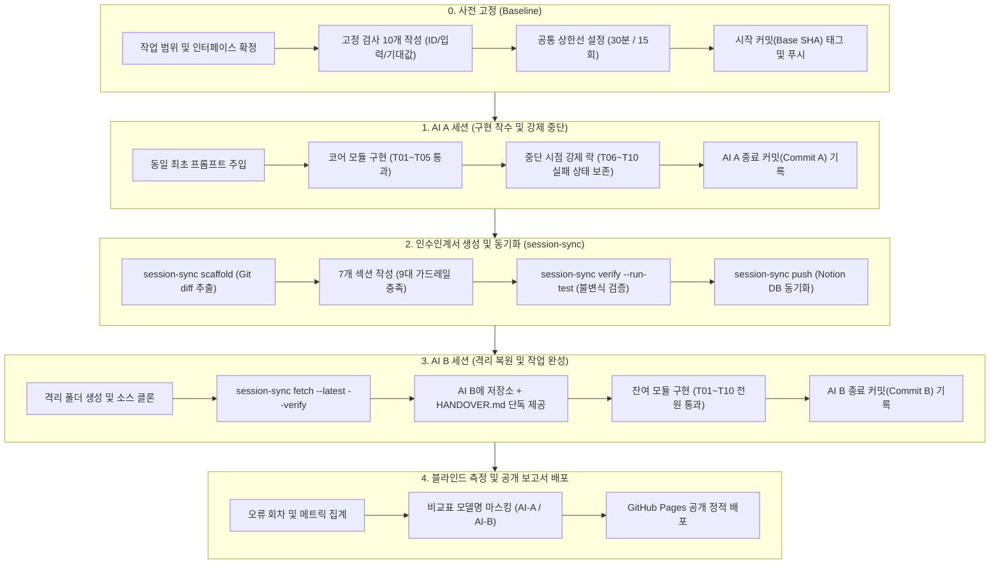

# 과제 5 실행 계획서: session-sync 기반 멀티 AI 세션 인수인계 파이프라인

## 1. 개요 및 설계 원칙

본 문서는 `aleph-04-daily` 레포지토리를 대상으로 과제 5(대화가 끊겨도 이어지는 프로젝트)를 수행하기 위한 전공정 실행 계획이다. `session-sync` CLI(Notion 2-Tier DB + 로컬 영속화 엔진)를 활용하여 대화 컨텍스트 없이 Git VCS 불변식과 7개 규격 인수인계 문서만으로 AI A에서 AI B로 작업을 무손실 이양한다.



---

## 2. 대상 작업 및 고정 검사 10개 (T05-C01 ~ T05-C04)

### 2.1 개선 대상 기능
- **대상 레포지토리**: `https://github.com/mmmphyun/aleph-04-daily`
- **구현 대상 모듈**: `src/resilience.js` (관측 어댑터 장애 격리용 서킷 브레이커 및 지수 백오프 엔진)
- **도입 목적**: 기존 `scripts/test-adapter.js`의 단발성 실패 처리를 개선하여, 외부 소스 장애 발생 시 연쇄 지연을 차단하는 3상태(`CLOSED`, `OPEN`, `HALF_OPEN`) 상태머신 및 지수 백오프 재시도 큐 구축.

### 2.2 고정 검사 10개 명세표
검사 스크립트 경로: `scripts/test-resilience.js` (Node.js 내장 `node:assert` 기반, 외부 의존성 없음)

| 검사 ID | 검증 목표 | 입력값 (Arguments) | 관찰 가능한 기대값 (Exit 0 Assertion) |
|:---|:---|:---|:---|
| `TEST-01` | 정상 상태 처리 | `circuit.execute(() => Promise.resolve(200))` | 반환값 `200`, 상태 `CLOSED`, 실패 카운트 `0` |
| `TEST-02` | 단일 실패 카운팅 | `circuit.execute(() => Promise.reject(new Error('500')))` | 에러 Throw, 상태 `CLOSED`, 실패 카운트 `1` |
| `TEST-03` | 임계치 도달 시 OPEN 전이 | 임계치 3회 설정 후 3회 연속 Reject 주입 | 3회차 호출 후 상태 `OPEN`, `last_state_change` 타임스탬프 갱신 |
| `TEST-04` | OPEN 상태 빠른 실패 (Fail-Fast) | 상태 `OPEN`일 때 추가 요청 실행 | 원본 함수 미호출, 즉시 `CircuitOpenError` Throw, 소요시간 < 2ms |
| `TEST-05` | 쿨다운 만료 후 HALF_OPEN 전이 | 상태 `OPEN` 후 쿨다운 시간(100ms) 경과 후 호출 | 상태 `HALF_OPEN`으로 전이, 탐침(Probe) 요청 1건 실행 허용 |
| `TEST-06` | HALF_OPEN 상태에서 성공 시 복구 | 상태 `HALF_OPEN`일 때 성공 Promise 주입 | 상태 `CLOSED` 복구, 실패 카운트 `0` 리셋 |
| `TEST-07` | HALF_OPEN 상태에서 실패 시 재오픈 | 상태 `HALF_OPEN`일 때 실패 Promise 주입 | 상태 즉시 `OPEN` 복귀, 쿨다운 타이머 재설정 |
| `TEST-08` | 지수 백오프 딜레이 계산 | `calculateBackoff(attempt=3, base=100, max=1000)` | 반환 딜레이 `400ms` (`base * 2^(attempt-1)`), 지터 범위 내 검증 |
| `TEST-09` | 최대 백오프 상한선 제한 | `calculateBackoff(attempt=10, base=100, max=1000)` | 반환 딜레이가 `1000ms`를 초과하지 않음 (`Math.min` 불변식) |
| `TEST-10` | Dead Letter Queue(DLQ) 적재 | 최대 재시도(3회) 초과 실패 페이로드 주입 | `dlq.length === 1`, 적재 객체에 `payload`, `error`, `timestamp` 포함 |

---

## 3. 공통 작업 상한 및 AI 모델 설정 (T05-C05, T05-C06, T05-C39)

- **공통 시간 상한**: **30분** (AI A, AI B 동일 적용)
- **공통 요청/호출 수 상한**: **15회** (AI A, AI B 동일 적용)
- **AI A 모델**: `Claude 3.5 Sonnet` (Anthropic Claude Desktop / Web Interface)
- **AI B 모델**: `GPT-4o` (OpenAI ChatGPT Interface)
- **두 모델에 동일하게 주입할 최초 요청문**:
```text
https://github.com/mmmphyun/aleph-04-daily 레포지토리의 src/resilience.js 모듈을 구현하여 서킷 브레이커와 지수 백오프 엔진을 완성해야 합니다.
검사 스크립트는 scripts/test-resilience.js에 정의된 고정 검사 10개(TEST-01 ~ TEST-10)이며, 실행 명령은 `node scripts/test-resilience.js` 입니다.
시작 때 고정된 테스트 파일(scripts/test-resilience.js)의 기대값, 검사 로직, ID를 수정하거나 삭제하는 행위는 엄격히 금지됩니다.
오직 src/resilience.js 파일만 신규 작성하거나 수정하여 테스트를 통과시키십시오.
```

---

## 4. 단계별 실행 프로토콜

### 4.1 Phase 0: 작업 전 고정 및 사전 준비 (Baseline)
1. `c:/work/aleph-04-daily` 작업 트리 클린 상태 확인:
   ```powershell
   git status --short
   ```
2. 검사 러너 작성 (`scripts/test-resilience.js`):
   - 고정 검사 10개(TEST-01 ~ TEST-10) 하드코딩 구현.
   - 실패 시 Non-zero exit code(`process.exit(1)`), 성공 시 `process.exit(0)` 보장.
3. 기준 커밋 생성 및 원격 푸시:
   ```powershell
   git add scripts/test-resilience.js
   git commit -m "test(resilience): 과제5 서킷 브레이커 및 백오프 고정 검사 10개 추가"
   git push origin main
   ```
4. Base Commit Full SHA (40자리) 기록 및 불변식 고정.

### 4.2 Phase 1: AI A 세션 (구현 착수 및 계획적 중단)
1. 세션 개시 및 시작 시각, 시작 커밋 기록.
2. AI A에 최초 요청문과 Base Commit 상태 소스 제공.
3. AI A 작업 진행:
   - `src/resilience.js` 생성 및 서킷 브레이커 기본 상태 머신 구현.
4. **계획적 중단 시점 강제**:
   - `TEST-01` ~ `TEST-05` 5개 통과, `TEST-06` ~ `TEST-10` 5개 실패 시점에서 추가 프롬프트 중단.
5. 로컬 검사 실행 및 결과 로그 캡처:
   ```powershell
   node scripts/test-resilience.js
   ```
6. AI A 중간 작업 커밋 생성:
   ```powershell
   git add src/resilience.js
   git commit -m "feat(resilience): 서킷 브레이커 기본 상태머신 및 Fail-Fast 구현 (A 세션)"
   git rev-parse HEAD # Commit A Full SHA 획득
   ```
7. AI A 실제 소요 시간(분) 및 대화 턴/호출 수 집계.

### 4.3 Phase 2: 인수인계서 생성 및 동기화 (session-sync 활용)
1. `session-sync scaffold` 실행하여 작업 트리 기반 초안 생성:
   ```powershell
   session-sync scaffold --out HANDOVER.md --force
   ```
2. 9대 가드레일 규격에 맞추어 `HANDOVER.md` 7개 필수 섹션 기재:
   - **목표**: 서킷 브레이커 잔여 로직(복구, 지수 백오프, DLQ) 완성 및 10개 전수 통과.
   - **현재 상태**: `TEST-01`~`TEST-05` PASS, `TEST-06`~`TEST-10` FAIL. ADR 명시(`[채택]`, `[이유]`, `[기각 대안]`). Base Commit SHA 명시.
   - **실행 명령**: `node scripts/test-resilience.js` 코드 블록 명시.
   - **통과 검사**: PASS된 `TEST-01` ~ `TEST-05` ID 및 검증 내역 기재.
   - **남은 문제**: FAIL된 `TEST-06` ~ `TEST-10` 원인 분석 및 미구현 인터페이스 명시.
   - **다음 행동**: `src/resilience.js`의 `calculateBackoff`, `dlq.push`, 반열림 성공 복구 로직 구현 순서 및 파라미터 I/O 명시.
   - **건드리지 말 것**: `scripts/test-resilience.js`, `scripts/test-adapter.js`, `src/adapter.js`.
3. 로컬 불변식 검증 실행:
   ```powershell
   session-sync verify --run-test
   ```
4. Notion DB 및 로컬 아카이브 푸시:
   ```powershell
   session-sync push --file HANDOVER.md --phase A_END --pass 5 --fail 5 --tags "t05,circuit-breaker"
   ```

### 4.4 Phase 3: AI B 세션 (격리 복원 및 작업 완성)
1. 격리된 신규 디렉토리 생성 및 소스 클론:
   ```powershell
   git clone https://github.com/mmmphyun/aleph-04-daily.git c:/work/aleph-04-daily-session-b
   cd c:/work/aleph-04-daily-session-b
   git checkout <Commit-A-SHA>
   ```
2. `session-sync`를 통한 인수인계서 인출 및 검증:
   ```powershell
   session-sync fetch --latest --out HANDOVER.md --verify
   ```
3. AI B 세션 개시:
   - **제공 자료**: Commit A 코드 베이스 + `HANDOVER.md` 1장만 단독 입력.
   - **금지 사항**: AI A의 대화 전문, 채팅 로그, 프롬프트 히스토리 일체 제공 금지.
4. AI B에 잔여 5개 검사 통과 지시:
   - `HANDOVER.md`의 `다음 행동`에 정의된 I/O 명세에 따라 `src/resilience.js` 수정.
5. 검사 실행 및 10개 전수 통과 확인:
   ```powershell
   node scripts/test-resilience.js
   # 10 PASS, 0 FAIL 확인
   ```
6. AI B 최종 커밋 생성 및 푸시:
   ```powershell
   git add src/resilience.js
   git commit -m "feat(resilience): 지수 백오프 딜레이 계산 및 DLQ 적재 파이프라인 완성 (B 세션)"
   git push origin main
   git rev-parse HEAD # Commit B Full SHA 획득
   ```
7. AI B 최종 세션 푸시:
   ```powershell
   session-sync push --file HANDOVER.md --phase B_END --pass 10 --fail 0 --tags "t05,complete"
   ```

### 4.5 Phase 4: 블라인드 측정 및 공개 비교 보고서 배포
1. 오류 회차(고정 검사 실행 중 1개 이상 FAIL이 발생한 회차 수) 집계:
   - AI A 오류 회차: 1차 실패, 2차 일부 통과 등 실행 로그 기반 카운트.
   - AI B 오류 회차: 인계 후 실행 시점부터 전수 통과까지의 실패 실행 횟수.
2. 소스 변경량(Churn) 산출:
   ```powershell
   # AI A 변경량
   git diff --stat <Base-SHA> <Commit-A-SHA> -- src/resilience.js
   # AI B 변경량
   git diff --stat <Commit-A-SHA> <Commit-B-SHA> -- src/resilience.js
   ```
3. 정적 HTML 보고서 생성 (`docs/report.html` 또는 GitHub Pages 루트):
   - 모델명 블라인드 처리 (`AI-A`, `AI-B`).
   - 무로그인 접근 검증: HTTP Basic Auth, Cookie, 시크릿 세션 없이 시크릿 창에서 즉시 렌더링.

---

## 5. Red Teaming 분석 (위험 요인 및 대안 검토)

### 5.1 잠재적 실패 모드 1: Notion API 의존성 및 네트워크 레이턴시
- **위험 요소**:
  - `session-sync push/fetch` 실행 시 Notion API의 Rate Limit(초당 3회 초과 시 HTTP 429)에 걸리거나 인증 만료 시 인수인계 파이프라인 전체가 블로킹됨.
  - 외부 네트워크 단절 시 AI B가 인수인계서를 조회하지 못하는 단일 장애점(SPOF) 발생.
- **방어 기제 및 대안**:
  - `session-sync`에 내장된 로컬 Failover 아카이브(`--failover-archive`) 플래그 사용.
  - Notion API 호출 실패 시 `.session-memory/archives/` 로컬 디렉토리에서 즉시 Fallback 복원하도록 보장.

### 5.2 잠재적 실패 모드 2: AI B의 암묵적 테스트 코드 수정 (T05-C18 ~ C20 위반)
- **위험 요소**:
  - AI B가 잔여 실패 테스트를 해결하기 위해 `src/resilience.js` 대신 `scripts/test-resilience.js`의 Assertion 값을 임의로 변경하거나 주석 처리하여 '가짜 100% 통과'를 만들 가능성.
- **방어 기제 및 대안**:
  - 인수인계서의 `건드리지 말 것` 섹션에 `scripts/test-resilience.js` 경로를 절대 수정 금지로 박제.
  - 커밋 전 `git diff <Base-SHA> HEAD -- scripts/test-resilience.js`를 기계적으로 실행하여 변경량이 `0 bytes`임을 검증하는 Git pre-commit 훅 또는 CI 스크립트 강제.

---

## 6. 과제 제출 체크리스트 및 서식 템플릿

### 6.1 제출 데이터 매핑
| 제출 항목 | 기재 내용 규격 |
|:---|:---|
| **결과물 URL** | `https://mmmphyun.github.io/aleph-04-daily/report.html` (무로그인 공개) |
| **소스 저장소 URL** | `https://github.com/mmmphyun/aleph-04-daily/commit/<Commit-B-Full-40-SHA>` |

### 6.2 짧은 확인 방법 4줄 (T05-C30 규격)
1. **어디로 가나요**: `https://mmmphyun.github.io/aleph-04-daily/report.html`
2. **무엇을 하나요 (3단계 이내)**:
   - 1) 상단 '실행 재현 로그' 영역의 '검사 실행(Test Run)' 버튼 클릭
   - 2) 블라인드 비교표에서 'AI-A vs AI-B 메트릭 대조군' 확인
   - 3) 하단 '인수인계 무결성 검증'에서 Git Commit SHA 일치 여부 확인
3. **무엇이 보이면 통과**: 고정 검사 10개(TEST-01~10) 전체 녹색(PASS) 표기, AI-A(5/10) 대비 AI-B(10/10) 달성 확인, 커밋 해시 일치.
4. **안 될 때**: TEST-06~10 중 적색(FAIL) 항목 표시, SHA 불일치 경고문구 출력.

### 6.3 AI와 나의 판단 3줄 (T05-C31 규격)
1. **AI에게 맡긴 일**: 서킷 브레이커 상태머신 전이 로직 및 지수 백오프 수식 코드 생성, 1차 검사 실패 로그 분석.
2. **학생이 직접 판단한 일**: 테스트 스위트의 절대 불변성을 위해 `scripts/test-resilience.js` 파일을 격리하고, AI A의 강제 중단 시점을 5개 통과 시점으로 고정하여 세션 이양 경계를 물리적으로 확정함.
3. **AI 제안을 따르지 않은 일**: AI A가 테스트 코드(`test-resilience.js`)의 비동기 타임아웃을 늘리자고 제안했으나, 검사 규격 완화(T05-C19 위반)에 해당하므로 즉시 기각하고 소스 코드 내 타이머 처리 로직만 수정하도록 통제함.
